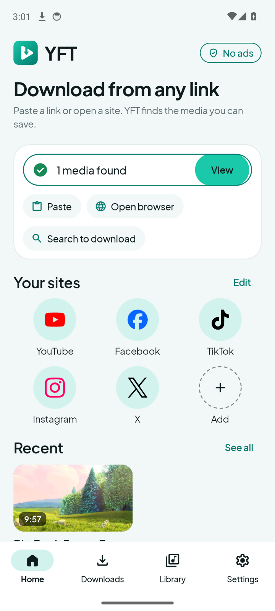
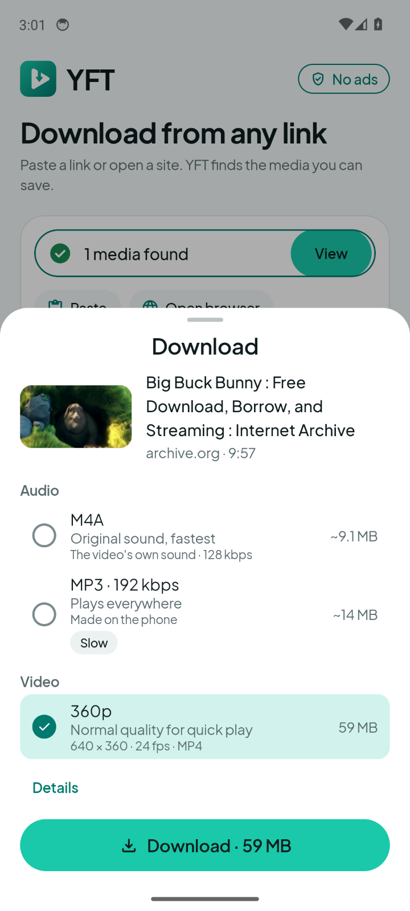
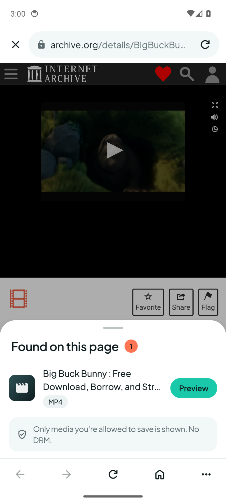
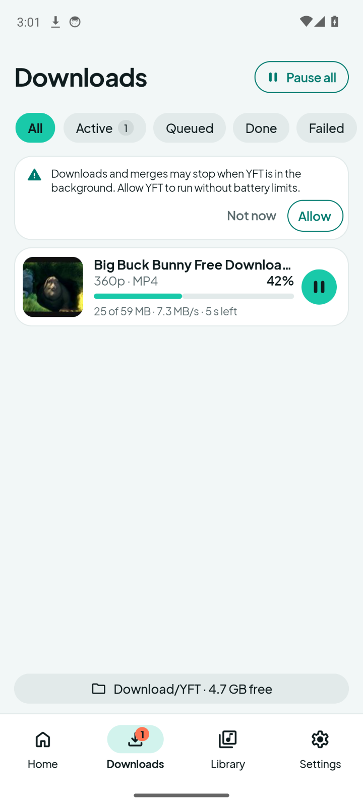
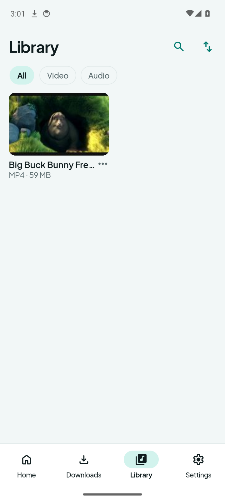
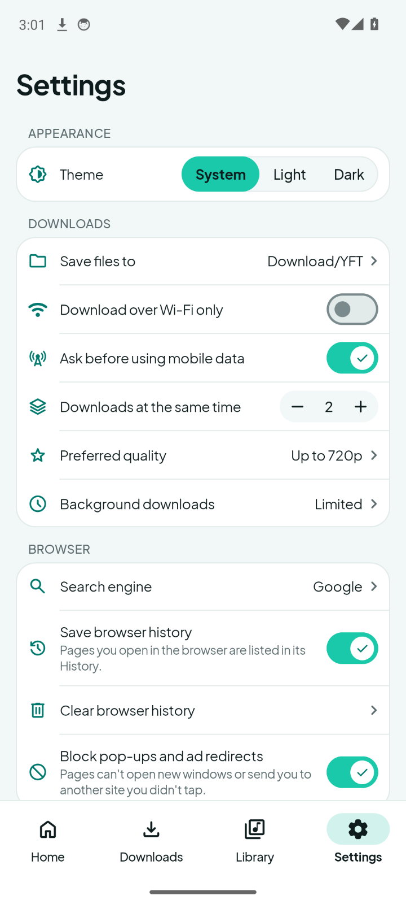
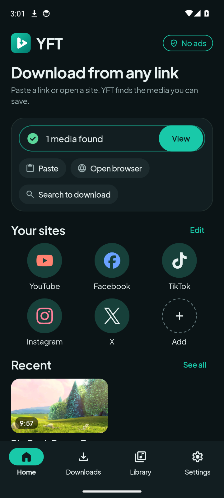

<p align="center">
  
</p>

<h1 align="center">YFT — Video Downloader</h1>

<p align="center">
  An ad-free Android app that finds, previews and saves the videos and audio you can watch.
</p>

<p align="center">
  <a href="https://github.com/Alalkipgen/YFT/releases/latest"></a>
  
  
  <a href="LICENSE"></a>
</p>

<p align="center">
  <a href="https://github.com/Alalkipgen/YFT/releases/latest"><b>Download the latest APK</b></a>
  ·
  <a href="#install">Install</a>
  ·
  <a href="#supported-sites">Supported sites</a>
  ·
  <a href="CHANGELOG.md">Changelog</a>
</p>

## Screenshots

<table>
  <tr>
    <td align="center"><br><sub><b>Home</b></sub></td>
    <td align="center"><br><sub><b>Download sheet</b></sub></td>
    <td align="center"><br><sub><b>Found on this page</b></sub></td>
    <td align="center"><br><sub><b>Downloads</b></sub></td>
  </tr>
  <tr>
    <td align="center"><br><sub><b>Library</b></sub></td>
    <td align="center"><br><sub><b>Settings</b></sub></td>
    <td align="center"><br><sub><b>Dark theme</b></sub></td>
    <td></td>
  </tr>
</table>

<sub>The screenshots come from the current code on a Pixel 6-sized emulator. They show the public
sample <i>Big Buck Bunny</i> (© Blender Foundation, CC BY 3.0) from [Internet Archive](https://archive.org/details/BigBuckBunny_124).</sub>

## Features

- **Paste or share a link.** Paste a link on Home, or share one from another app. The Download
  sheet opens with available qualities and sizes when known.
- **Built-in browser.** Browse any site. When a page plays a video, tap **Download**. In a feed,
  YFT can find the video on screen on supported feeds.
- **Video and audio.** Pick a quality, or save the sound alone as M4A or MP3. Separate video and
  compatible video and sound tracks are merged on the phone.
- **Streams, not just files.** Direct files, HTML5 players, HLS and DASH streams. A `blob:`
  address is never saved as a file: YFT finds the real source behind it.
- **Reliable downloads.** Downloads run in the background with pause, resume and Retry. An
  expired link is renewed with Fresh link.
- **Backup finder.** When a site's own lookup finds no video, the Backup finder looks again.
- **Library.** Play, share and delete saved files, and choose the folder they are saved to.
- **Your choice of look.** Light and dark themes that follow the system or your pick.
- **Updates in the app.** Settings → About → Updates checks for and installs new releases.
- **No ads, no account.** YFT has no ads and never signs in to a site for you.

## Supported sites

| Site | What YFT saves |
| --- | --- |
| YouTube | Videos and Shorts, up to 2160p, and their audio |
| Facebook | Videos, reels, watch links and posts with video |
| Instagram | Videos in posts and reels |
| TikTok | Videos from full and short links |
| X (Twitter) | Videos and GIFs in posts |
| Vimeo | Public and unlisted videos |
| VK | Videos and clips on `vk.com`, `vk.ru` and `vkvideo.ru` |
| Other sites | The page's own video, found by the Page video finder |

Sites change often, so a site can break between releases. The full list of links, qualities and
limits is in the [support matrix](docs/SUPPORT_MATRIX.md).

## Install

YFT needs **Android 7.0 (API 24)** or newer and targets Android 15 (API 35). It is shared only on
[GitHub Releases](https://github.com/Alalkipgen/YFT/releases).

1. Download `video-downloader-<version>.apk` and `SHA256SUMS` from the
   [latest release](https://github.com/Alalkipgen/YFT/releases/latest).
2. Check the file: `sha256sum -c SHA256SUMS` (on Windows, `Get-FileHash`).
3. Open the APK on your phone. Allow your browser or file manager to install apps when Android
   asks.

New releases install over the old one and keep your files and settings. YFT can also update
itself in **Settings → About → Updates**. Release notes are in [docs/release/](docs/release/).

## Privacy and boundaries

- YFT shows no ads and has no account.
- The site adapters never sign in. Your own browser session is sent only to that site's hosts.
- YFT does not bypass DRM, payment, private access or age checks.
- A site is listed as supported only when tests back it.

The decisions behind these rules are in [docs/DECISIONS.md](docs/DECISIONS.md).

## For developers

### Build and test

You need JDK 17 and Android SDK 35.

```bash
./gradlew lintDebug testDebugUnitTest :core-model:test :extractor-api:test \
  :extractor-generic:test :extractor-sites:test :extractor-master:test :app:assembleDebug
```

`./gradlew :app:assembleRelease` builds `app-release-unsigned.apk` unless release signing is set up
([docs/RELEASE.md](docs/RELEASE.md)). On a machine with about 4 GiB of RAM and no swap, run the
tests and `:app:assembleRelease` as separate Gradle runs. More commands, the CI workflows and the
phone tests are in [docs/TESTING.md](docs/TESTING.md). `bash scripts/readme-screenshots.sh` takes
the screenshots above on an emulator.

### Documents

| Document | What it holds |
| --- | --- |
| [AGENTS.md](AGENTS.md) | Rules for agents who work in this repository |
| [docs/ARCHITECTURE.md](docs/ARCHITECTURE.md) | Modules, data flow, main and Master, build flags, security |
| [docs/DESIGN.md](docs/DESIGN.md) | The design system and the rules the screens follow |
| [docs/DECISIONS.md](docs/DECISIONS.md) | Decisions already made |
| [docs/PLAN.md](docs/PLAN.md) | What is open: owner decisions, backlog, risks |
| [docs/TESTING.md](docs/TESTING.md) | Test commands, CI workflows, phone tools, runbooks |
| [docs/RELEASE.md](docs/RELEASE.md) | Release identity, signing, preview builds, publishing |
| [docs/SUPPORT_MATRIX.md](docs/SUPPORT_MATRIX.md) | What each site and feature supports |
| [docs/GLOSSARY.md](docs/GLOSSARY.md) | Feature names, and old work labels mapped to them |
| [docs/SESSION_STATE.md](docs/SESSION_STATE.md) | Where the current work stands |
| [docs/THIRD_PARTY_NOTICES.md](docs/THIRD_PARTY_NOTICES.md) | Third-party code and licenses |
| [CHANGELOG.md](CHANGELOG.md) | Changes per version |
| [extractor-master](extractor-master/README.md), [extractor-master-android](extractor-master-android/README.md) | Master's two modules |

### Reference

[AlalDownloader](https://github.com/Alalkipgen/AlalDownloader) (MIT) is a reference for browser
request context, segmented downloads, queueing, pause, resume and recovery. YFT does not depend on
it at run time.

## License

YFT is released under the [MIT License](LICENSE). Third-party code and its licenses are listed in
[docs/THIRD_PARTY_NOTICES.md](docs/THIRD_PARTY_NOTICES.md).
